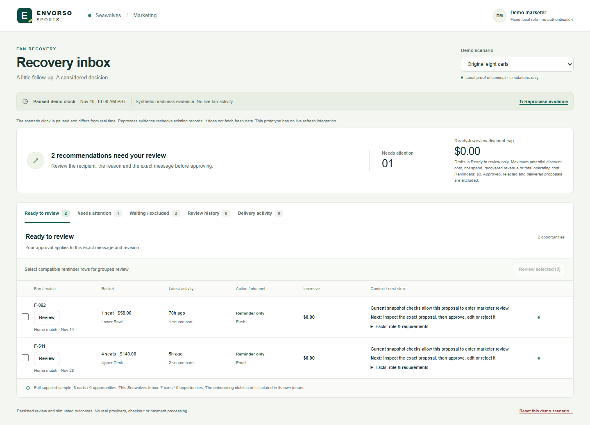
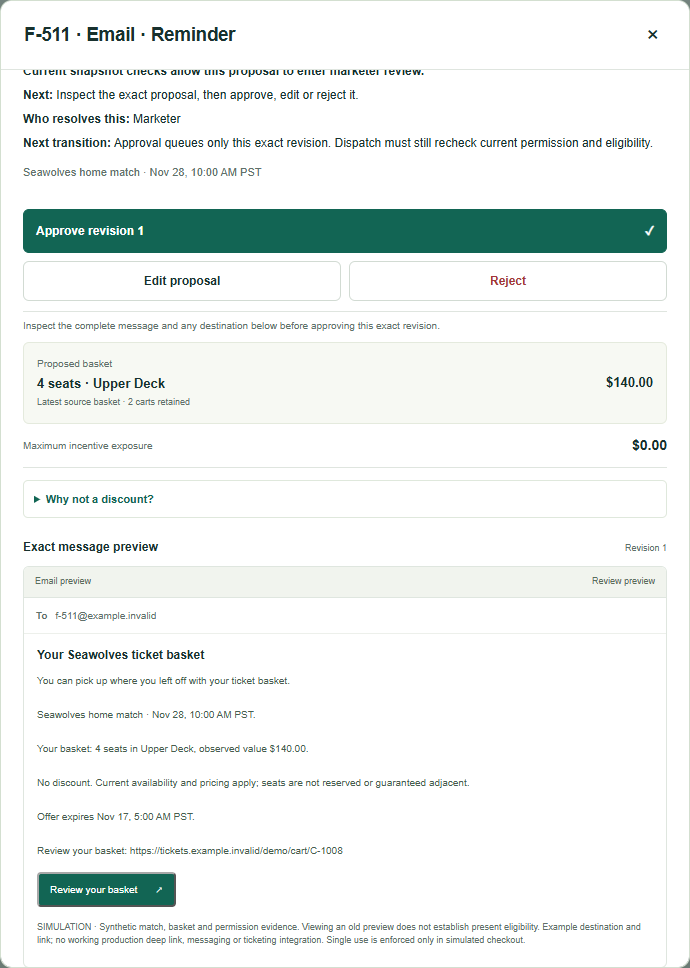
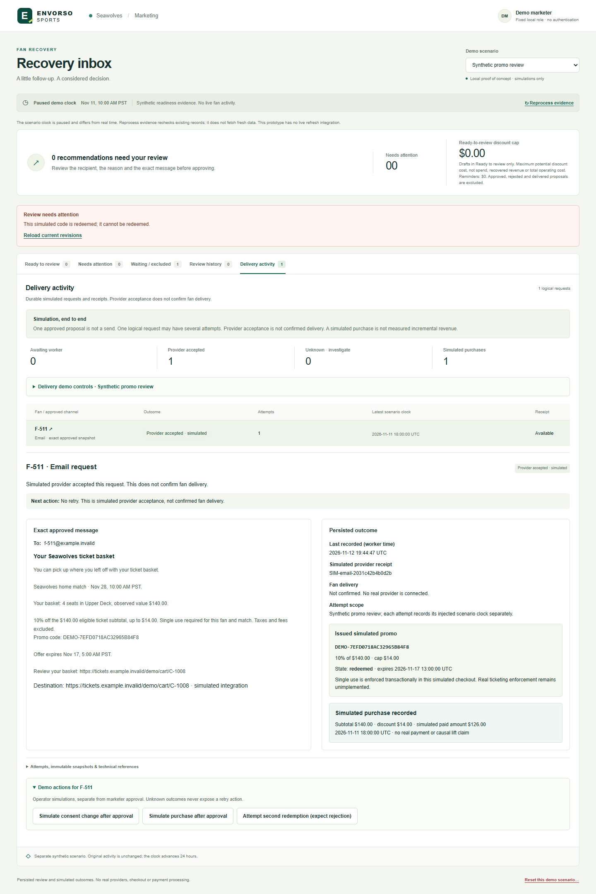
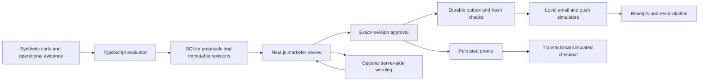

# Envorso Fan Offer Engine

Fans start ticket purchases and leave their baskets behind. This project turns that activity into proposals a marketer can review, edit, approve or reject, with a reason and a clear next step.


*Short reasons and next actions stay visible; full context is available inside Review or the row expansion.*

## What it does

- Resolves related account, guest and cross-device activity without adding basket values together.
- Applies deterministic eligibility and offer rules, then proposes a permitted email or push channel.
- Binds approval to an exact immutable revision, individually or in a compatible reminder batch.
- Rechecks evidence before simulated delivery and retains receipts and uncertain outcomes.
- Issues a persisted promo code with single-use enforcement inside simulated checkout.

## Walkthrough

Choose **Original eight carts → Review F-511 → Edit proposal → Save new draft → Approve**, then inspect **Delivery activity** and run the local simulator. Approval alone sends nothing. **Review your basket** opens a read-only local snapshot, not real checkout.

**Synthetic review workload** uses `SYN-F-...` identifiers for batch testing. **Synthetic promo review** contains F-511's separate 10% offer on a $140 subtotal, capped at $14. These are isolated scenarios, not extra supplied fans or live campaigns.


*Individual review identifies the fan, channel and action. Changed wording needs a new approval.*

| Example | Initial decision | Why |
| --- | --- | --- |
| F-511 | Email reminder | Linked account/guest activity; latest activity controls timing |
| F-092 | Push reminder | Email opted out; push is independently checked |
| F-204 | Wait | Latest activity two hours ago; reminder minimum is four hours |
| F-333 | Needs attention | Club ticketing staff must clarify season-pass coverage |
| Played match | Excluded | Recovery is no longer appropriate |
| Onboarding club | Isolated and held | Its own team is not activated |


*Acceptance and purchase are separate simulated states. This is not recovered revenue.*

## Where AI helps

Optional wording suggestions offer a subject or opening for human review, with deterministic templates as the complete fallback. Eligibility, consent, pricing, financial limits and sending authority remain deterministic. No measured conversion improvement, personalization or time savings is claimed.

## Architecture



## Run locally

Verified on Windows/PowerShell with **Node 22.17.0** and **npm 10.9.2**. Node's built-in `node:sqlite` is required. Dependencies are pinned in the lockfile.

```powershell
npm ci --ignore-scripts --no-audit --no-fund
npm run db:migrate
npm run db:seed
npm run dev
```

Open **http://127.0.0.1:3000**. For a local production build, use `npm run build` then `npm start`. Templates, manual editing and simulators need no credentials.

State persists in `data/recovery.sqlite`; seeding adds only missing scenarios. For separate rehearsal, set `$env:RECOVERY_DB_PATH = Join-Path (Get-Location) 'data/rehearsal.sqlite'` before seeding and starting. The scenario clock is paused and differs from real time. **Reprocess evidence** rechecks existing records; it does not fetch fresh data. Advancing the clock can make evidence stale and block a proposal.

For optional AI, copy `.env.example` to ignored `.env.local`, add your own key locally and set `COPY_DRAFT_ENABLED=true`. The server model is configurable through `OPENAI_COPY_MODEL` (default `gpt-6-luna`). Restart after configuration changes. Never use a `NEXT_PUBLIC` key or commit credentials. The example keeps AI disabled.

## Verification

```powershell
npm test
npm run typecheck
npm run build
npm run test:browser
```

The verified release candidate passed **136 tests**, TypeScript, production build and an actual Chrome walkthrough, plus clean extraction/install/build and credential-free startup. Browser checks require installed Chrome or Edge, use isolated databases and visibly label copy fixtures. No GitHub Actions result is claimed. See [verification evidence](docs/VERIFICATION.md).

## Limits and next steps

This is a local demo role without production authentication, using synthetic operational evidence, simulated providers and simulated checkout. Provider acceptance is not confirmed fan delivery. There is no universal exactly-once guarantee or measured revenue lift. Real data feeds, authenticated access and provider/ticketing integrations are future work. Timing and incentive thresholds are initial hypotheses; the four-hour reminder minimum is unchanged.

Read the [technical notes](docs/TECHNICAL_NOTES.md), [engine](src/domain/engine.ts), [review service](src/review/store.ts), [outbox](src/outcome/store.ts) and [tests](test/) for detail. Challenge submission and rehearsal documents remain separate local materials.
